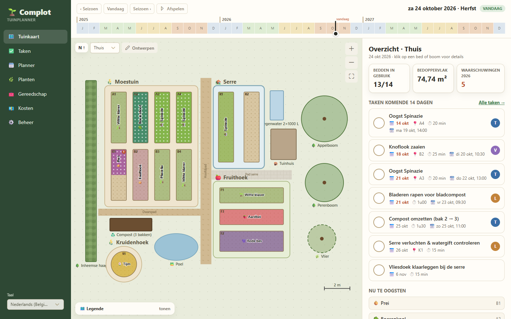
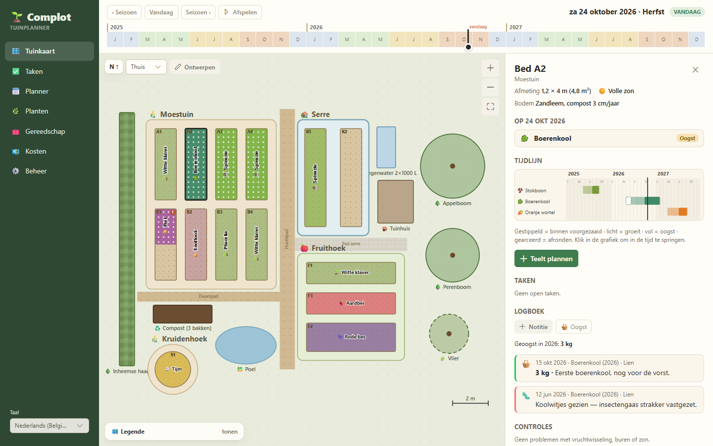
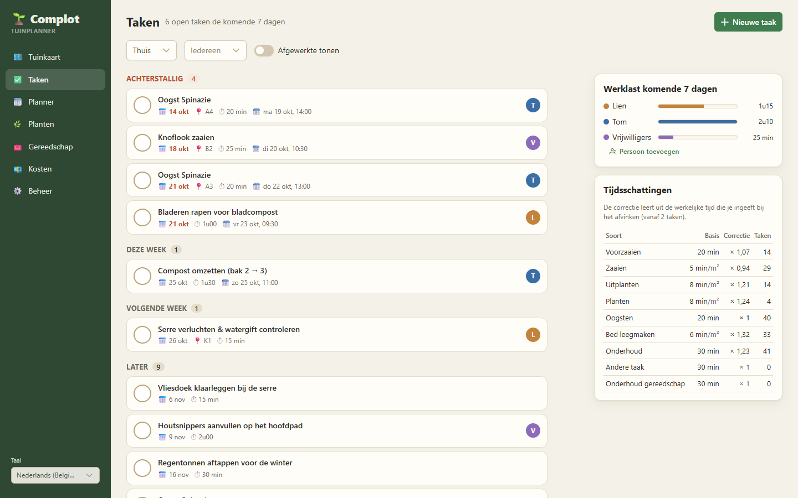
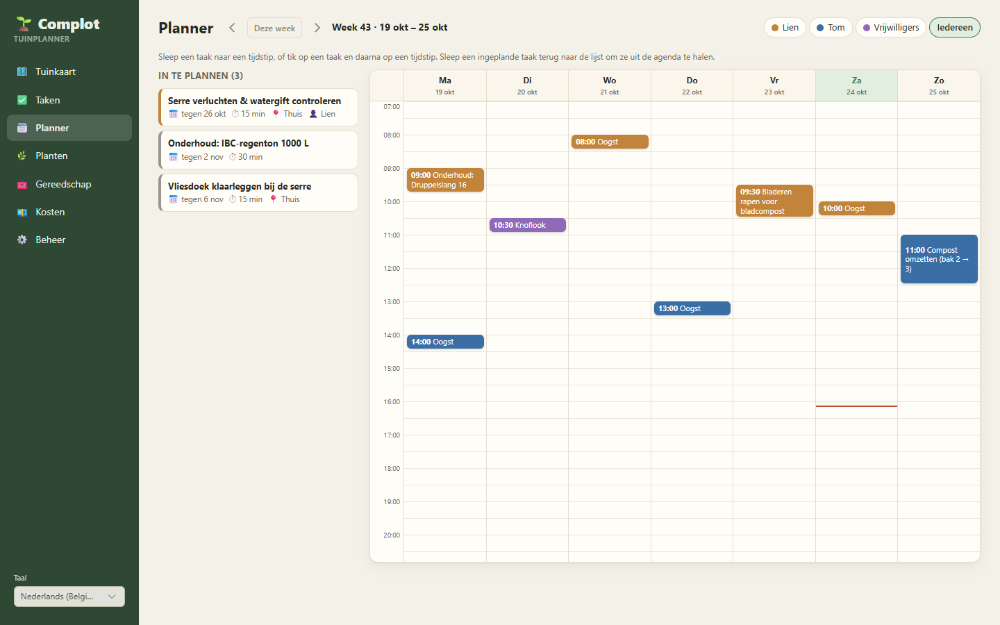
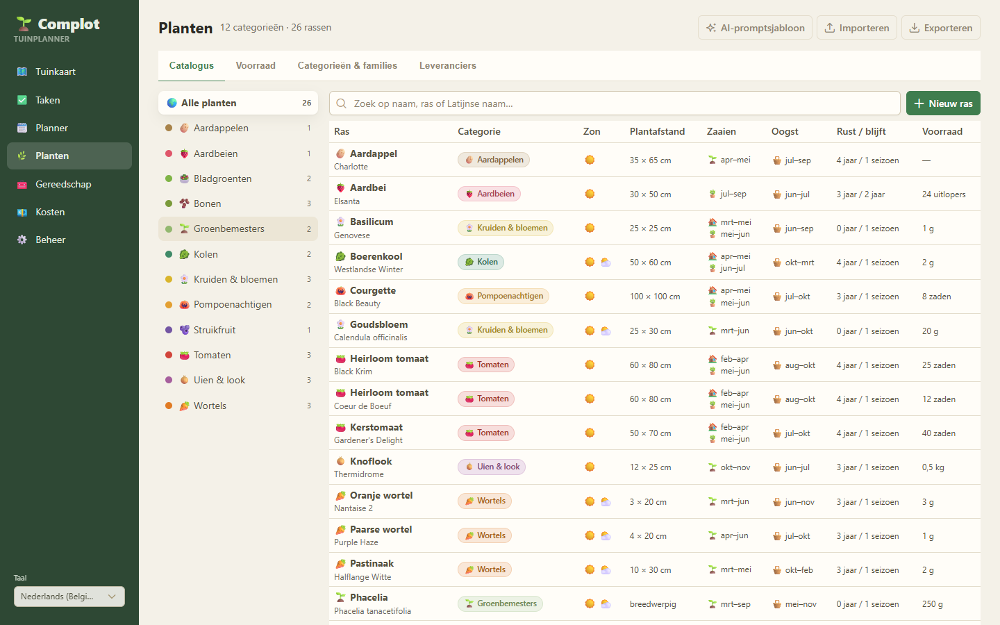
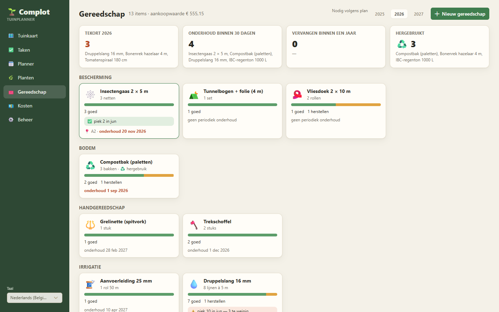
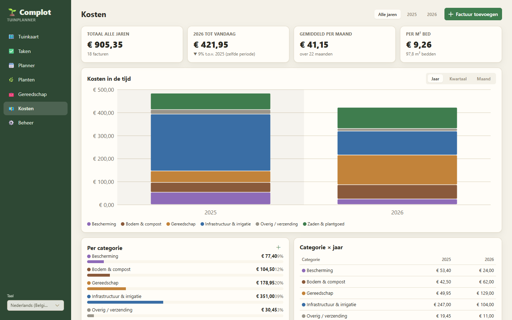
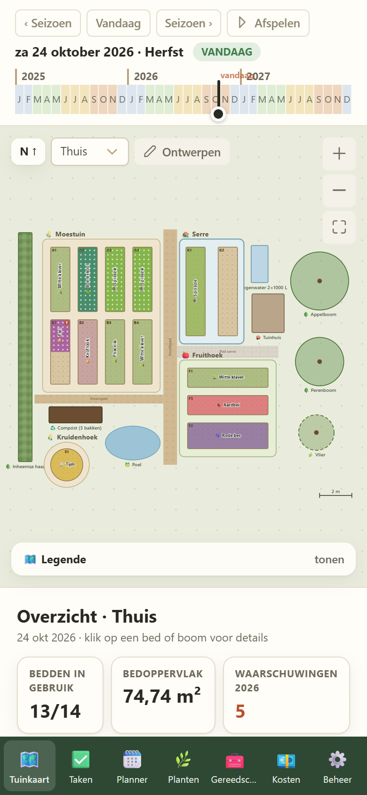
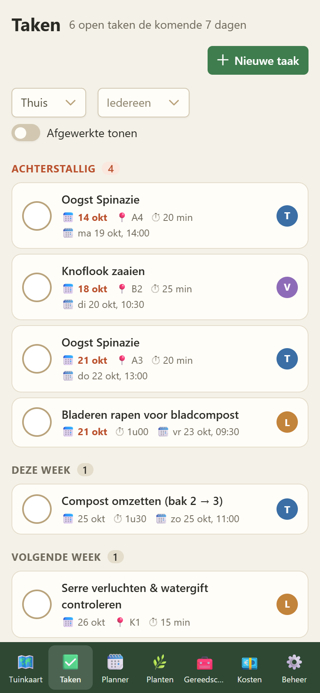

<div align="center">

# 🌱 Complot

**A garden planner for small-scale, circular, permaculture growing.**

Draw your garden, plan crops with rotation per botanical family, and let the tasks, calendar, tools and costs follow from the plan.




</div>

The UI is Dutch (Belgium) by default, with English as a second language. See [PLAN.md](PLAN.md) for scope and
decisions and `demo/index.html` for the clickable prototype.

## Features

### 🗺️ Garden map and season timeline

Sites, beds, paths, trees and water drawn to scale. Scrub the timeline (or press *Afspelen*) to watch the
season unfold: each bed shows its crop and phase, from sown to harvest to cleared. Click a bed for its history,
rotation and companion checks, open tasks and log.



### ✅ Tasks that learn and 🗓️ a planner

Tasks come from the crop plan (sow, plant out, harvest, clear) and from tools that need maintenance, plus your own.
Time estimates correct themselves from the actual time you enter when ticking them off. Drag tasks onto a person's
week in the planner, and they show up in Google Calendar or any calendar app.

| Tasks | Planner |
|---|---|
|  |  |

### 🌿 Plants, 🧰 tools and 💶 costs

A plant catalog with spacing, sowing and harvest windows, rotation rules and seed inventory (with import/export and
an AI prompt template to fill it). Tools with condition, maintenance and the demand that follows from the plan.
Invoices split per category, with a cost report per year and per m² of bed.

| Plants | Tools | Costs |
|---|---|---|
|  |  |  |

### 📱 On your phone, in the garden

<p>
  
  &nbsp;
  
</p>

### 🔐 Access per location

Optional OpenID Connect sign-in, *view* or *edit* access per location, invitations by e-mail and time-limited
access links for volunteers (see [Users and access](#users-and-access)).

## Structure

| Folder | Contents |
|---|---|
| `backend/` | .NET 10: `Complot.Domain` (entities and rules, no framework), `Complot.Api` (minimal APIs, EF Core + SQLite), tests |
| `frontend/` | Vue 3 + TypeScript with Vite+ (`vp`), PrimeVue 4 (MIT), vue-i18n, TanStack Query |
| `docker/` | Dockerfile (single image: API + built frontend) and docker-compose |

The backend is the single source of truth for rules and validation. On every backend build the OpenAPI document is
written to `frontend/src/shared/api/openapi.json` and NSwag generates the typed client `client.ts` from it, so a
change to an API contract shows up as a TypeScript error in the frontend. Validation errors are sent as codes with
parameters (`notEmpty`, `inclusiveBetween {from, to}`, `category.inUse`) and translated in the frontend.

## Requirements

- .NET SDK 10 (`backend/global.json`)
- Node.js 24 LTS (`.nvmrc`; 22.18+ also works) and Vite+: `npm install --global vite-plus@1.4.0`
  (Vite+ installs the pnpm version pinned in `frontend/package.json`)

## Run locally

```bash
# API on http://localhost:5180, fills an empty database with the demo garden (Development settings)
cd backend/src/Complot.Api
dotnet run

# Frontend on http://localhost:5173, proxies /api and /auth to the API
cd frontend
vp install
vp dev
```

API reference (Development only): http://localhost:5180/scalar

## Checks

```bash
cd backend && dotnet test          # domain rules + API integration tests
cd frontend && vp run verify       # vue-tsc (templates too), format + lint, unit tests, license check
```

## Configuration

| Setting (env var) | Default | Meaning |
|---|---|---|
| `Storage__DataDir` | `app-data` (`/data` in Docker) | SQLite database and uploaded photos |
| `Seed__DemoData` | `true` in Development | Fill an empty database with the demo catalog and garden |
| `Auth__Oidc__Authority`, `Auth__Oidc__ClientId`, `Auth__Oidc__ClientSecret` | empty | OpenID Connect sign-in; empty = open (internal use) |
| `Auth__Admins` | empty | With sign-in: comma-separated e-mail addresses that are always admin |
| `Google__ClientId`, `Google__ClientSecret` | empty | Google OAuth client for linking people's Google Calendars (planner) |
| `TZ` | system | Time zone of the garden: planned times are local times there (Docker: `Europe/Brussels`) |

### Users and access

Without OIDC everybody has full access. With OIDC, the addresses in `Auth__Admins` are admins. On the **Beheer** page
admins create, archive and delete locations, invite users by e-mail and give them *view* or *edit* access per
location (the invitation is linked at the first sign-in). Anyone else who signs in sees "waiting for access" and shows
up on that page. Changing shared data (catalog, people) needs edit access to at least one location. An archived
location is hidden and read-only; only an archived location can be deleted, which removes everything on it.

### Planner and calendars

Drag tasks onto a person's week (or tap a task, then a time). Scheduled tasks can reach people's calendars in two ways:

- **iCal link** (no setup): in the planner, choose a person and *Agendalink maken*. Subscribe to that URL in Google
  Calendar (*Other calendars → From URL*) or any calendar app. Read-only, and Google refreshes it only every few hours.
- **Google Calendar** (instant, two-way free/busy): each person links their own Google account in the planner. Complot
  then writes their scheduled tasks as events (marked "free", so they do not block other appointments) and shows their
  busy times in the planner. Set it up once:
  1. In [Google Cloud Console](https://console.cloud.google.com/) create a project, enable the **Google Calendar API**,
     and configure the OAuth consent screen (*External*; scopes `calendar.events` and `calendar.freebusy`).
  2. Create an OAuth client of type **Web application** with redirect URI
     `https://<your-host>/api/planner/google/callback` (locally: `http://localhost:5180/api/planner/google/callback`).
  3. Set `Google__ClientId` and `Google__ClientSecret`.

  While the consent screen is in *Testing*, only listed test users can link, and Google expires the link after 7 days.
  Publishing the app (Google shows an "unverified app" warning for a small private app) avoids the weekly re-linking.

The encryption keys for sign-in cookies and Google tokens are kept in the data directory (`keys/`), so keep that
directory with the database in backups.

**Access links** (Beheer → Toegangslinks) give access without an account, e.g. for volunteers: choose the rights per
location and a "valid until" date, and share the link (it is shown once; only a hash is stored). Opening it signs the
browser in until that date; deleting the link or making a new one ends that access immediately.

## Docker

```bash
cp docker/.env.example docker/.env
docker compose -f docker/docker-compose.yml up -d --build   # http://localhost:8080
```
